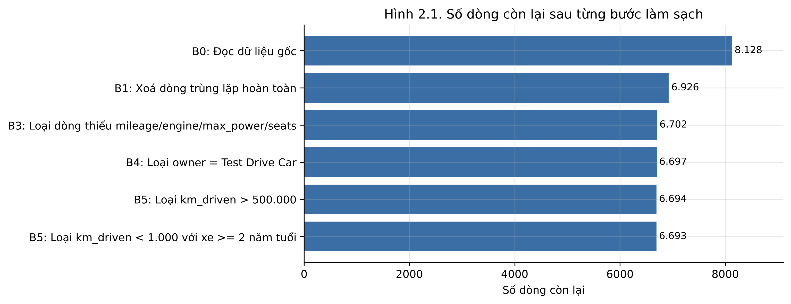
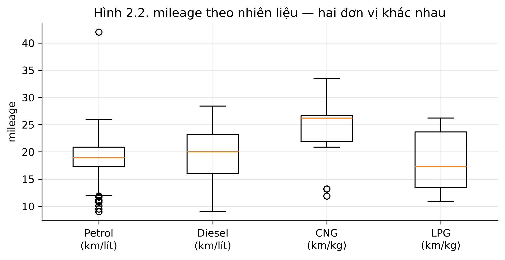
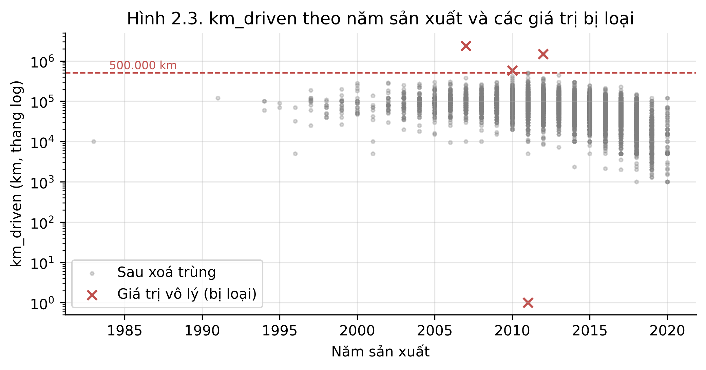
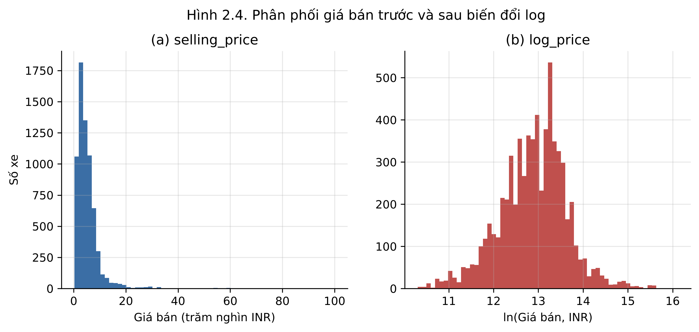

# CHƯƠNG 2. CƠ SỞ LÝ THUYẾT VÀ DỮ LIỆU

Chương này trình bày các khái niệm và phương pháp thống kê được sử dụng trong báo cáo (mục 2.1 – 2.6), kèm điều kiện
áp dụng và lý do lựa chọn đối với dữ liệu của nhóm; mục 2.7 mô tả dữ liệu và quy trình tiền xử lý.

## 2.1. Tổng thể, mẫu và biến

**Tổng thể** là tập hợp tất cả các đối tượng cần nghiên cứu — ở đây là các xe ô tô cũ được rao bán trên thị trường
Ấn Độ. **Mẫu** là tập con quan sát được của tổng thể — 6.693 tin rao trên CarDekho.com sau làm sạch. Các đại lượng
tính trên tổng thể gọi là **tham số** (ví dụ trung bình $\mu$, phương sai $\sigma^2$, tỷ lệ $p$); các đại lượng tính trên
mẫu gọi là **thống kê** (trung bình mẫu $\bar{x}$, phương sai mẫu $s^2$, tỷ lệ mẫu $\hat{p}$) và được dùng để ước lượng,
kiểm định tham số.

Theo bản chất, biến được chia thành **biến định lượng** (giá, số km, tuổi xe, dung tích, công suất) và **biến định tính**
(nhiên liệu, hộp số, loại người bán, số đời chủ). Theo thang đo:

: Bảng 2.1. Các thang đo của biến trong dữ liệu

| Thang đo | Đặc điểm | Biến trong dữ liệu |
|---|---|---|
| Định danh (nominal) | Chỉ phân loại, không có thứ tự | `fuel`, `transmission`, `seller_type`, `brand` |
| Thứ bậc (ordinal) | Có thứ tự, khoảng cách giữa các mức không xác định | `owner` (số đời chủ, mã hoá `owner_rank` = 1 … 4) |
| Khoảng (interval) | Có khoảng cách đều, không có điểm 0 tuyệt đối | `year` |
| Tỷ lệ (ratio) | Có điểm 0 tuyệt đối, phép chia có nghĩa | `selling_price`, `km_driven`, `car_age`, `engine`, `max_power`, `mileage`, `seats` |

*Nguồn: Nhóm nghiên cứu.*

Thang đo quyết định phương pháp phù hợp: biến thứ bậc như `owner` nên được phân tích bằng phương pháp dựa trên hạng
(Spearman, Kruskal-Wallis, kiểm định xu hướng) thay vì coi khoảng cách giữa các mức là bằng nhau.

## 2.2. Thống kê mô tả

### 2.2.1. Đo lường xu hướng trung tâm

Với mẫu $x_1, x_2, \dots, x_n$:

* **Trung bình mẫu:** $\bar{x} = \dfrac{1}{n}\sum_{i=1}^{n} x_i$. Nhạy với giá trị cực đoan.
* **Trung vị** $Me$: giá trị đứng giữa dãy đã sắp xếp (trung bình hai giá trị giữa nếu $n$ chẵn). Bền vững với ngoại lai,
  nên phản ánh "mức giá điển hình" tốt hơn trung bình khi phân phối lệch.
* **Mốt:** giá trị xuất hiện nhiều nhất, dùng chủ yếu cho biến định tính.

### 2.2.2. Đo lường độ phân tán

* **Phương sai mẫu** và **độ lệch chuẩn mẫu** (chia cho $n-1$ để là ước lượng không chệch của $\sigma^2$):
  $$s^2 = \frac{1}{n-1}\sum_{i=1}^{n}(x_i - \bar{x})^2, \qquad s = \sqrt{s^2}.$$
* **Khoảng tứ phân vị:** $IQR = Q_3 - Q_1$, trong đó $Q_1, Q_3$ là phân vị 25% và 75%. Một quan sát được coi là
  *ngoại lai tiềm năng* theo quy tắc Tukey (1977) nếu nằm ngoài $[Q_1 - 1{,}5\,IQR;\ Q_3 + 1{,}5\,IQR]$ — đây cũng là
  quy tắc vẽ "râu" của biểu đồ hộp (boxplot).
* **Hệ số biến thiên:** $CV = s/\bar{x}$, dùng để so sánh độ phân tán giữa các biến khác đơn vị.

### 2.2.3. Đo lường hình dạng phân phối

* **Hệ số bất đối xứng (skewness):**
  $$g_1 = \frac{\frac{1}{n}\sum (x_i-\bar{x})^3}{\left[\frac{1}{n}\sum (x_i-\bar{x})^2\right]^{3/2}}.$$
  $g_1 > 0$: phân phối lệch phải (đuôi dài về phía giá trị lớn); $g_1 < 0$: lệch trái; $|g_1| > 1$ thường được coi là
  lệch mạnh.
* **Hệ số nhọn vượt chuẩn (excess kurtosis):**
  $$g_2 = \frac{\frac{1}{n}\sum (x_i-\bar{x})^4}{\left[\frac{1}{n}\sum (x_i-\bar{x})^2\right]^{2}} - 3.$$
  Phân phối chuẩn có $g_2 = 0$; $g_2 > 0$ cho thấy đuôi dày hơn chuẩn (nhiều giá trị cực đoan). Thư viện `pandas` dùng
  phiên bản hiệu chỉnh chệch của hai hệ số này.

### 2.2.4. Trực quan hoá

* **Histogram** và **ước lượng mật độ hạt nhân (KDE)** mô tả hình dạng phân phối của biến định lượng.
* **Biểu đồ hộp (boxplot)** so sánh trung vị, IQR và ngoại lai giữa các nhóm (theo hãng, nhiên liệu, hộp số).
* **Biểu đồ phân tán (scatter plot)** thể hiện quan hệ giữa hai biến định lượng (giá theo tuổi xe, số km, công suất).
* **Biểu đồ cột** thể hiện tần số, tỷ lệ của biến định tính.
* **Biểu đồ Q-Q (quantile–quantile)** so sánh phân vị mẫu với phân vị lý thuyết của phân phối chuẩn; các điểm nằm
  gần đường thẳng cho thấy dữ liệu xấp xỉ chuẩn.

### 2.2.5. Hệ số tương quan

* **Hệ số tương quan Pearson** đo mức độ liên hệ **tuyến tính** giữa hai biến định lượng:
  $$r = \frac{\sum (x_i-\bar{x})(y_i-\bar{y})}{\sqrt{\sum (x_i-\bar{x})^2\sum (y_i-\bar{y})^2}}, \qquad -1 \le r \le 1.$$
* **Hệ số tương quan hạng Spearman** $r_s$ là hệ số Pearson tính trên **hạng** của dữ liệu; đo mức độ liên hệ
  **đơn điệu**, bền vững với ngoại lai và dùng được cho biến thứ bậc. Khi không có hạng trùng:
  $r_s = 1 - \dfrac{6\sum d_i^2}{n(n^2-1)}$, với $d_i$ là chênh lệch hạng của quan sát $i$.

Kiểm định $H_0: \rho = 0$ dùng thống kê $t = r\sqrt{(n-2)/(1-r^2)}$ có phân phối Student với $n-2$ bậc tự do. Lưu ý:
tương quan không đồng nghĩa với nhân quả.

## 2.3. Phép biến đổi logarit

Giá xe là biến dương, lệch phải mạnh và có phương sai tăng theo mức giá (xe đắt dao động giá lớn hơn xe rẻ). Phép biến
đổi $y = \ln(\text{giá})$ có ba tác dụng: (1) giảm độ lệch, đưa phân phối về gần đối xứng; (2) ổn định phương sai giữa
các nhóm; (3) biến các tác động **tỷ lệ** (phần trăm) thành tác động **cộng**, phù hợp với bản chất của giá.

**Diễn giải hệ số trong mô hình log-tuyến tính** $\ln y = \beta_0 + \beta_1 x + \dots$: khi $x$ tăng 1 đơn vị (các biến
khác không đổi), giá thay đổi $100\,(e^{\beta_1}-1)\%$; khi $|\beta_1|$ nhỏ, xấp xỉ $100\,\beta_1\%$. Với biến giả
(dummy), $100\,(e^{\beta}-1)\%$ là chênh lệch giá của nhóm đó so với nhóm tham chiếu.

**Quy đổi ngược:** nếu $\bar{y}$ là trung bình của $\ln(\text{giá})$ thì $e^{\bar{y}}$ là **trung bình hình học** của giá,
xấp xỉ trung vị khi $\ln(\text{giá})$ gần đối xứng — **không phải** trung bình số học. Tương tự, dự báo $e^{\hat{y}}$ từ mô
hình log có xu hướng thấp hơn giá trung bình kỳ vọng; có thể hiệu chỉnh bằng hệ số "smearing" của Duan (1983):
$\hat{\text{giá}} = e^{\hat{y}}\cdot\frac{1}{n}\sum e^{\hat{\varepsilon}_i}$.

## 2.4. Ước lượng tham số

### 2.4.1. Ước lượng điểm và ước lượng khoảng

Ước lượng điểm dùng một giá trị thống kê ($\bar{x}$, $\hat{p}$) để ước lượng tham số. **Khoảng tin cậy (KTC)** mức
$1-\alpha$ là khoảng ngẫu nhiên $[L; U]$ sao cho nếu lặp lại việc lấy mẫu nhiều lần, khoảng $1-\alpha$ (ví dụ 95%) số
khoảng tạo ra sẽ chứa tham số thật. KTC càng hẹp khi cỡ mẫu càng lớn và độ phân tán càng nhỏ.

### 2.4.2. Khoảng tin cậy cho trung bình

Khi $\sigma$ chưa biết, với mẫu đủ lớn hoặc tổng thể xấp xỉ chuẩn:
$$\bar{x} \pm t_{\alpha/2;\,n-1}\,\frac{s}{\sqrt{n}}.$$
Theo **định lý giới hạn trung tâm**, phân phối của $\bar{x}$ xấp xỉ chuẩn khi $n$ lớn ngay cả khi dữ liệu không chuẩn;
tuy nhiên với biến lệch mạnh như giá xe và với các nhóm nhỏ (CNG: 50 xe, LPG: 35 xe), xấp xỉ này kém chính xác. Do đó
báo cáo áp dụng một trong hai cách:

* **Tính KTC trên thang log rồi đổi ngược:** $\left[e^{\bar{y} - t\,s_y/\sqrt{n}};\ e^{\bar{y} + t\,s_y/\sqrt{n}}\right]$, là KTC
  cho trung bình hình học (xấp xỉ trung vị) của giá; khoảng này không đối xứng quanh ước lượng điểm.
* **Bootstrap phần trăm (percentile bootstrap)** (Efron & Tibshirani, 1993): lấy lại mẫu có hoàn lại $B$ lần (ví dụ
  $B = 10.000$), tính thống kê trên mỗi mẫu lặp, KTC 95% là phân vị 2,5% và 97,5% của $B$ giá trị đó. Phương pháp không
  cần giả định phân phối.

### 2.4.3. Khoảng tin cậy cho tỷ lệ

KTC Wald $\hat{p} \pm z_{\alpha/2}\sqrt{\hat{p}(1-\hat{p})/n}$ đơn giản nhưng kém chính xác khi $\hat{p}$ gần 0 hoặc 1.
Báo cáo dùng **KTC Wilson** (Wilson, 1927):
$$\frac{\hat{p} + \dfrac{z^2}{2n} \pm z\sqrt{\dfrac{\hat{p}(1-\hat{p})}{n} + \dfrac{z^2}{4n^2}}}{1 + \dfrac{z^2}{n}}, \qquad z = z_{\alpha/2}.$$
Ví dụ áp dụng: tỷ lệ xe số tự động trong mẫu (khoảng 8,5%).

## 2.5. Kiểm định giả thuyết thống kê

### 2.5.1. Các khái niệm cơ bản

* **Giả thuyết không** $H_0$ (thường là "không có khác biệt / không có liên hệ") và **giả thuyết đối** $H_1$.
* **Mức ý nghĩa** $\alpha$ = xác suất bác bỏ $H_0$ khi $H_0$ đúng (**sai lầm loại I**); nhóm dùng $\alpha = 0{,}05$.
  **Sai lầm loại II** ($\beta$) là không bác bỏ $H_0$ khi $H_0$ sai; **lực kiểm định** = $1-\beta$.
* **Giá trị p (p-value):** xác suất, khi $H_0$ đúng, thu được giá trị thống kê kiểm định cực đoan ít nhất như giá trị
  quan sát. Quy tắc: bác bỏ $H_0$ nếu $p \le \alpha$.
* **Ý nghĩa thống kê khác ý nghĩa thực tiễn.** Với mẫu hàng nghìn quan sát, khác biệt rất nhỏ cũng có thể cho
  $p < 0{,}05$. Vì vậy mỗi kiểm định đều phải báo cáo kèm **hệ số ảnh hưởng** (mục 2.5.7).

Quy trình chung: (1) phát biểu $H_0$, $H_1$, $\alpha$ **trước khi** chạy; (2) kiểm tra giả định để chọn kiểm định phù
hợp; (3) tính thống kê và p-value; (4) tính hệ số ảnh hưởng; (5) kết luận bằng lời trong bối cảnh thực tế.

### 2.5.2. Kiểm tra giả định

**Phân phối chuẩn.** Kiểm định **Shapiro-Wilk** (Shapiro & Wilk, 1965) có $H_0$: dữ liệu lấy từ phân phối chuẩn, với
thống kê
$$W = \frac{\left(\sum_{i=1}^{n} a_i x_{(i)}\right)^2}{\sum_{i=1}^{n}(x_i-\bar{x})^2},$$
trong đó $x_{(i)}$ là thống kê thứ tự và $a_i$ là hệ số tính từ phân phối chuẩn. Với mẫu rất lớn (thư viện `scipy` cảnh
báo khi $n > 5.000$), kiểm định có lực rất cao nên gần như luôn bác bỏ $H_0$ dù độ lệch khỏi chuẩn không đáng kể về
thực tế. Do mẫu sau làm sạch có $n = 6.693$, nhóm đánh giá tính chuẩn chủ yếu bằng **biểu đồ Q-Q**, **hệ số bất đối xứng
và hệ số nhọn**, kết hợp với định lý giới hạn trung tâm; Shapiro-Wilk chỉ dùng tham khảo hoặc cho các nhóm nhỏ.

**Đồng nhất phương sai.** Kiểm định **Levene** (Levene, 1960) — phiên bản dùng trung vị của Brown và Forsythe (1974) —
có $H_0: \sigma_1^2 = \sigma_2^2 = \dots = \sigma_k^2$; ít nhạy với việc dữ liệu không chuẩn hơn kiểm định Bartlett.

### 2.5.3. So sánh hai nhóm độc lập

**Kiểm định t hai mẫu.** Phiên bản Student giả định hai nhóm có phương sai bằng nhau. **Kiểm định t Welch** (Welch, 1947)
không cần giả định này:
$$t = \frac{\bar{x}_1 - \bar{x}_2}{\sqrt{\dfrac{s_1^2}{n_1} + \dfrac{s_2^2}{n_2}}}, \qquad
\nu = \frac{\left(\dfrac{s_1^2}{n_1} + \dfrac{s_2^2}{n_2}\right)^2}{\dfrac{(s_1^2/n_1)^2}{n_1-1} + \dfrac{(s_2^2/n_2)^2}{n_2-1}}.$$
Khi hai nhóm có cỡ mẫu chênh lệch lớn (xe số sàn 6.127 so với số tự động 566) và phương sai khác nhau, Welch t-test giữ
được mức sai lầm loại I đúng trong khi Student t-test thì không; vì vậy nhóm dùng **Welch t-test trên `log_price`** làm
mặc định.

**Kiểm định Mann-Whitney U** (Mann & Whitney, 1947) là phương án phi tham số dựa trên hạng:
$U_1 = R_1 - n_1(n_1+1)/2$, với $R_1$ là tổng hạng của nhóm 1. $H_0$: phân phối của hai nhóm như nhau (xác suất một
quan sát của nhóm 1 lớn hơn một quan sát của nhóm 2 bằng 0,5). Dùng để kiểm tra lại độ vững của kết luận.

### 2.5.4. So sánh nhiều nhóm

**Phân tích phương sai một yếu tố (one-way ANOVA)** kiểm định $H_0: \mu_1 = \mu_2 = \dots = \mu_k$ bằng
$$F = \frac{SS_B/(k-1)}{SS_W/(N-k)}, \quad SS_B = \sum_{j} n_j(\bar{x}_j - \bar{x})^2, \quad SS_W = \sum_j\sum_i (x_{ij}-\bar{x}_j)^2,$$
với giả định độc lập, chuẩn trong từng nhóm và phương sai bằng nhau. Khi cỡ nhóm lệch nhiều và phương sai khác nhau
(như nhóm CNG/LPG chỉ 85 xe so với Diesel 3.651 xe), dùng **Welch ANOVA** (Welch, 1951).

**Kiểm định Kruskal-Wallis** (Kruskal & Wallis, 1952) là phương án phi tham số dựa trên hạng:
$$H = \frac{12}{N(N+1)}\sum_{j=1}^{k}\frac{R_j^2}{n_j} - 3(N+1) \ \sim\ \chi^2_{k-1} \text{ (xấp xỉ)}.$$

**Hậu kiểm (post-hoc).** Khi bác bỏ $H_0$, cần xác định cặp nhóm nào khác nhau:

* **Tukey HSD** — sau ANOVA cổ điển, giả định phương sai bằng nhau;
* **Games-Howell** (Games & Howell, 1976) — sau Welch ANOVA, không cần phương sai bằng nhau, phù hợp cỡ nhóm lệch;
* **Dunn** (Dunn, 1964) — sau Kruskal-Wallis, so sánh tổng hạng; p-value hiệu chỉnh theo Holm. Không dùng Tukey HSD sau
  Kruskal-Wallis vì Tukey dựa trên trung bình và giả định của ANOVA.

**Biến thứ bậc** (`owner`): ngoài so sánh nhóm, kiểm tra **xu hướng** (giá giảm dần theo số đời chủ) bằng hệ số Spearman
giữa `owner_rank` và giá, hoặc kiểm định Jonckheere-Terpstra.

### 2.5.5. Kiểm định tính độc lập Chi-bình phương

Với bảng tiếp liên $r \times c$ của hai biến định tính, $H_0$: hai biến độc lập. Tần số kỳ vọng và thống kê kiểm định:
$$E_{ij} = \frac{(\text{tổng hàng } i)(\text{tổng cột } j)}{n}, \qquad
\chi^2 = \sum_{i,j}\frac{(O_{ij}-E_{ij})^2}{E_{ij}} \ \sim\ \chi^2_{(r-1)(c-1)}.$$
Điều kiện: mọi $E_{ij} \ge 5$ (hoặc không quá 20% ô có $E_{ij} < 5$ và không ô nào $< 1$). Nếu vi phạm, gộp các mức nhỏ
(ví dụ CNG và LPG thành `CNG/LPG`) hoặc dùng **kiểm định chính xác Fisher**.

### 2.5.6. Hiệu chỉnh đa kiểm định

Thực hiện $m$ kiểm định ở mức $\alpha$ làm xác suất mắc ít nhất một sai lầm loại I tăng lên tới $1-(1-\alpha)^m$.
**Phương pháp Holm** (Holm, 1979): sắp xếp p-value tăng dần $p_{(1)} \le \dots \le p_{(m)}$; bác bỏ lần lượt $H_{(i)}$ chừng nào
$p_{(i)} \le \alpha/(m-i+1)$, dừng ở giả thuyết đầu tiên không thoả. Holm kiểm soát sai lầm theo họ (FWER) như Bonferroni
nhưng có lực mạnh hơn.

### 2.5.7. Hệ số ảnh hưởng (effect size)

: Bảng 2.2. Hệ số ảnh hưởng và ngưỡng diễn giải

| Kiểm định | Hệ số ảnh hưởng | Công thức | Ngưỡng nhỏ / vừa / lớn |
|---|---|---|---|
| t-test hai mẫu | Cohen's $d$ | $d = (\bar{x}_1-\bar{x}_2)/s_p$, $s_p = \sqrt{\frac{(n_1-1)s_1^2+(n_2-1)s_2^2}{n_1+n_2-2}}$ | 0,2 / 0,5 / 0,8 |
| ANOVA | $\eta^2$ | $SS_B/SS_T$ | 0,01 / 0,06 / 0,14 |
| Kruskal-Wallis | $\varepsilon^2$ | $H/(N-1)$ | 0,01 / 0,06 / 0,14 (tham khảo) |
| Chi-bình phương | Cramér's $V$ | $\sqrt{\chi^2/[n(\min(r,c)-1)]}$ | 0,1 / 0,3 / 0,5 (khi $\min(r,c)=2$) |
| Tương quan | $r$, $r_s$ | — | 0,1 / 0,3 / 0,5 |

*Nguồn: Cohen (1988); Cramér (1946); Tomczak & Tomczak (2014).*

Với mô hình log, chênh lệch trung bình $\Delta$ của $\ln(\text{giá})$ giữa hai nhóm còn có thể diễn giải trực tiếp: nhóm 1 có
giá (trung bình hình học) cao hơn nhóm 2 khoảng $100\,(e^{\Delta}-1)\%$.

### 2.5.8. Giới hạn của kiểm định trên dữ liệu quan sát

Các kiểm định so sánh nhóm chỉ cho thấy **có khác biệt** giữa các nhóm, chưa loại bỏ được **yếu tố gây nhiễu**. Ví dụ, xe
số tự động trong mẫu có thể đắt hơn một phần vì chúng thường là xe đời mới hơn hoặc của hãng hạng sang. Để tách riêng tác
động của từng yếu tố khi giữ các yếu tố khác không đổi, cần mô hình hồi quy bội (mục 2.6).

## 2.6. Mô hình hồi quy tuyến tính bội

### 2.6.1. Mô hình và ước lượng OLS

Mô hình hồi quy tuyến tính bội với $k$ biến giải thích:
$$y_i = \beta_0 + \beta_1 x_{i1} + \beta_2 x_{i2} + \dots + \beta_k x_{ik} + \varepsilon_i, \qquad i = 1,\dots,n,$$
hay dạng ma trận $\mathbf{y} = \mathbf{X}\boldsymbol{\beta} + \boldsymbol{\varepsilon}$. Trong báo cáo, $y_i = \ln(\text{giá}_i)$.
Phương pháp bình phương tối thiểu thông thường (OLS) chọn $\hat{\boldsymbol\beta}$ cực tiểu tổng bình phương phần dư
$\sum \hat\varepsilon_i^2$, cho nghiệm
$$\hat{\boldsymbol{\beta}} = (\mathbf{X}^\top\mathbf{X})^{-1}\mathbf{X}^\top\mathbf{y}.$$
Hệ số $\beta_j$ là thay đổi kỳ vọng của $y$ khi $x_j$ tăng một đơn vị **và các biến khác giữ nguyên**.

### 2.6.2. Giả định Gauss-Markov

1. Mô hình tuyến tính theo tham số.
2. Mẫu ngẫu nhiên / các quan sát độc lập.
3. Không có đa cộng tuyến hoàn hảo ($\mathbf{X}$ có hạng đầy đủ).
4. Kỳ vọng sai số có điều kiện bằng 0: $E(\varepsilon_i \mid \mathbf{X}) = 0$.
5. Phương sai sai số không đổi (đồng nhất): $\operatorname{Var}(\varepsilon_i\mid\mathbf{X}) = \sigma^2$.

Khi các giả định 1 – 5 thoả mãn, **định lý Gauss-Markov** khẳng định ước lượng OLS là ước lượng tuyến tính không chệch tốt
nhất (BLUE). Giả định bổ sung sai số **phân phối chuẩn** giúp các kiểm định $t$, $F$ chính xác với mẫu nhỏ; với mẫu lớn,
các kiểm định này vẫn xấp xỉ đúng nhờ định lý giới hạn trung tâm (Wooldridge, 2020).

### 2.6.3. Đánh giá mức độ phù hợp và ý nghĩa

* **Hệ số xác định** $R^2 = 1 - SSR/SST$: tỷ lệ biến thiên của $y$ được mô hình giải thích. $R^2$ luôn tăng khi thêm biến,
  nên dùng **$R^2$ hiệu chỉnh**: $\bar{R}^2 = 1 - (1-R^2)\dfrac{n-1}{n-k-1}$.
* **Kiểm định F tổng thể:** $H_0: \beta_1 = \dots = \beta_k = 0$, $F = \dfrac{R^2/k}{(1-R^2)/(n-k-1)}$.
* **Kiểm định t từng hệ số:** $H_0: \beta_j = 0$, $t = \hat\beta_j/\operatorname{se}(\hat\beta_j) \sim t_{n-k-1}$.

### 2.6.4. Biến giả (dummy) cho biến định tính

Biến định tính có $m$ mức được mã hoá bằng $m-1$ biến giả 0/1; mức bị bỏ đi là **nhóm tham chiếu**. Đưa đủ $m$ biến giả
cùng hệ số chặn gây đa cộng tuyến hoàn hảo ("bẫy biến giả"). Biến có quá nhiều mức hiếm như `brand` (31 hãng, 12 hãng dưới
10 xe) cần **gộp nhóm** trước (ví dụ các hãng lớn + "Khác", hoặc hạng sang / phổ thông) để hệ số ước lượng ổn định.

### 2.6.5. Đa cộng tuyến và VIF

Khi các biến giải thích tương quan mạnh với nhau (ví dụ `engine` và `max_power`, $r \approx 0{,}68$), sai số chuẩn của hệ số
tăng, dấu hệ số có thể ngược với kỳ vọng. **Hệ số phóng đại phương sai**:
$$VIF_j = \frac{1}{1 - R_j^2},$$
với $R_j^2$ là hệ số xác định khi hồi quy $x_j$ theo các biến giải thích còn lại. Quy ước của nhóm: $VIF > 5$ là đáng lo
ngại (ngưỡng 10 cũng thường được dùng) — khi đó giữ một trong các biến tương quan hoặc gộp chúng.

### 2.6.6. Lựa chọn biến: AIC, BIC và stepwise

$$AIC = -2\ln L + 2p, \qquad BIC = -2\ln L + p\ln n,$$
với $L$ là hàm hợp lý cực đại và $p$ số tham số (Akaike, 1974; Schwarz, 1978). Mô hình có AIC/BIC nhỏ hơn được ưu tiên;
BIC phạt số biến mạnh hơn nên cho mô hình gọn hơn khi $n$ lớn. **Hồi quy từng bước (stepwise)** thêm/bớt lần lượt từng biến
sao cho AIC (hoặc BIC) giảm nhiều nhất, dừng khi không còn cải thiện. Stepwise chỉ là công cụ hỗ trợ: kết quả cần được so
sánh với mô hình đầy đủ và đánh giá về mặt ý nghĩa thực tế.

### 2.6.7. Chẩn đoán mô hình

* **Bốn đồ thị chẩn đoán phần dư:** (1) phần dư theo giá trị dự báo — kiểm tra tính tuyến tính và phương sai đồng nhất;
  (2) Q-Q plot của phần dư chuẩn hoá — kiểm tra tính chuẩn; (3) Scale-Location ($\sqrt{|\text{phần dư chuẩn hoá}|}$ theo giá trị
  dự báo) — kiểm tra phương sai; (4) phần dư theo đòn bẩy (leverage) kèm đường Cook — phát hiện điểm ảnh hưởng.
* **Kiểm định Breusch-Pagan** (Breusch & Pagan, 1979): hồi quy $\hat\varepsilon_i^2$ theo các biến giải thích;
  $LM = nR^2_{aux} \sim \chi^2_k$; $H_0$: phương sai sai số không đổi. Nếu bác bỏ, hệ số OLS vẫn không chệch nhưng sai số
  chuẩn thông thường sai → dùng **sai số chuẩn vững HC3** (MacKinnon & White, 1985; Long & Ervin, 2000).
* **Kiểm định Durbin-Watson** (Durbin & Watson, 1950): $DW = \sum_{i=2}^{n}(\hat\varepsilon_i - \hat\varepsilon_{i-1})^2 / \sum \hat\varepsilon_i^2 \approx 2(1-\hat\rho)$;
  $DW \approx 2$ cho thấy không có tự tương quan bậc 1. Kiểm định này dành cho dữ liệu **chuỗi thời gian**; với dữ liệu chéo
  như tin rao bán xe, thứ tự quan sát không có ý nghĩa nên giá trị DW chỉ được báo cáo kèm giải thích.
* **Kiểm tra phân phối chuẩn của phần dư:** Q-Q plot là chính; Shapiro-Wilk/Jarque-Bera chỉ tham khảo vì $n$ lớn.
* **Khoảng cách Cook** (Cook, 1977): đo mức thay đổi của toàn bộ giá trị dự báo khi bỏ quan sát $i$:
  $$D_i = \frac{\hat\varepsilon_i^2}{p\,\hat\sigma^2}\cdot\frac{h_{ii}}{(1-h_{ii})^2},$$
  với $h_{ii}$ là đòn bẩy. Quan sát có $D_i > 4/n$ được xem xét kỹ (không tự động loại bỏ).

### 2.6.8. Đánh giá khả năng dự báo

Dữ liệu được chia ngẫu nhiên thành **tập huấn luyện (80%)** và **tập kiểm tra (20%)** với `random_state = 42` (hoặc kiểm định
chéo k-fold). Mô hình ước lượng trên tập huấn luyện, đánh giá trên tập kiểm tra bằng:
$$RMSE = \sqrt{\frac{1}{n}\sum (y_i - \hat{y}_i)^2}, \qquad MAE = \frac{1}{n}\sum |y_i - \hat{y}_i|,$$
tính trên **thang giá gốc (INR)** sau khi quy đổi ngược từ log, để kết quả dễ hiểu. RMSE nhạy với sai số lớn hơn MAE.

## 2.7. Dữ liệu và quy trình tiền xử lý

### 2.7.1. Cơ sở lý thuyết của làm sạch dữ liệu

**Dòng trùng lặp** là các quan sát giống hệt nhau ở mọi biến — thường do một tin rao bị thu thập nhiều lần. Giữ lại sẽ
làm một số xe được đếm nhiều lần, vi phạm giả định các quan sát độc lập và làm khoảng tin cậy hẹp giả tạo.

**Giá trị khuyết** được phân loại theo cơ chế (Rubin, 1976; Little & Rubin, 2019): *MCAR* — thiếu hoàn toàn ngẫu nhiên;
*MAR* — việc thiếu phụ thuộc vào các biến quan sát được; *MNAR* — việc thiếu phụ thuộc vào chính giá trị bị thiếu. Loại bỏ
dòng thiếu (complete-case analysis) không gây chệch nếu MCAR và chấp nhận được khi tỷ lệ thiếu nhỏ; điền giá trị đơn giản
(trung bình, trung vị) làm giảm phương sai giả tạo và làm yếu quan hệ giữa các biến.

**Ngoại lai** có thể là (1) **lỗi** (nhập sai, đơn vị sai) — cần sửa hoặc loại; hoặc (2) **giá trị thật nhưng hiếm** —
phải giữ lại vì là một phần của tổng thể. Quy tắc IQR và Z-score ($|z| > 3$) chỉ là công cụ **phát hiện**; với biến lệch
phải tự nhiên như giá, chúng đánh dấu hàng loạt quan sát thật ở đuôi phải. Cách xử lý phù hợp là dùng biến đổi log hoặc
phương pháp bền vững, và chỉ loại các giá trị **vô lý về mặt thực tế**.

### 2.7.2. Dữ liệu gốc

Tệp `Car details v3.csv` gồm **8.128 dòng và 13 cột**: `name`, `year`, `selling_price`, `km_driven`, `fuel`, `seller_type`,
`transmission`, `owner`, `mileage`, `engine`, `max_power`, `torque`, `seats`. Các vấn đề phát hiện được tóm tắt ở Bảng 2.3.

: Bảng 2.3. Các vấn đề của dữ liệu gốc và cách xử lý

| Vấn đề | Mô tả | Cách xử lý |
|---|---|---|
| Dòng trùng lặp | 1.202 dòng trùng hoàn toàn (625 nhóm) | Xoá, giữ lần xuất hiện đầu — làm **đầu tiên** |
| Đơn vị lẫn trong chuỗi | `23.4 kmpl`, `1248 CC`, `74 bhp` | Tách phần số |
| Hai đơn vị `mileage` | `kmpl` (Petrol, Diesel) và `km/kg` (CNG, LPG) | Giữ cột `mileage_unit`, không so sánh chung |
| Giá trị khuyết | 208 tin thiếu cả 5 cột kỹ thuật (sau xoá trùng) | Loại dòng |
| Giá trị vô nghĩa | 15 ô `mileage = 0`; 4 ô `max_power` rỗng hoặc `0` | Coi là khuyết → loại dòng |
| `torque` không thống nhất | Khoảng 20 định dạng, lẫn N·m và kgf·m, có dòng ghi nhầm đơn vị | Tách `torque_nm` (biến phụ) |
| Mức hiếm | `Test Drive Car` (5 xe); `Trustmark Dealer` (236 dòng gốc, 27 xe sau xoá trùng) | Loại / gộp vào `Dealer` |
| Giá trị vô lý | `km_driven` = 2.360.457; 1.500.000; 577.414; 1 km (xe 2011) | Loại 4 dòng |
| Giá lệch phải mạnh | 29.999 – 10.000.000 INR, độ lệch 5,46 | **Không** cắt ngoại lai; dùng `log_price` |
| Không có cột hãng | Hãng nằm trong `name` | Tách `brand` |

*Nguồn: `notebooks/01_cleaning.ipynb`.*

### 2.7.3. Các bước làm sạch

Bảng 2.4 và Hình 2.1 trình bày số dòng còn lại sau từng bước.

: Bảng 2.4. Nhật ký làm sạch dữ liệu

| Bước | Nội dung | Trước | Bị loại | Còn lại |
|:---:|:--------------------------------------------|-----:|-----:|-----:|
| 0 | Đọc dữ liệu gốc | 8.128 | 0 | 8.128 |
| 1 | Xoá dòng trùng lặp hoàn toàn | 8.128 | 1.202 | 6.926 |
| 2 | Tách đơn vị `mileage`, `engine`, `max_power`, `torque` | 6.926 | 0 | 6.926 |
| 3 | Loại dòng thiếu `mileage`/`engine`/`max_power`/`seats` | 6.926 | 224 | 6.702 |
| 4 | Loại `owner = Test Drive Car`; gộp `Trustmark Dealer` vào `Dealer` | 6.702 | 5 | 6.697 |
| 5 | Loại `km_driven > 500.000` và `km_driven < 1.000` với xe ≥ 2 tuổi | 6.697 | 4 | 6.693 |
| 6 – 7 | Tạo biến mới, kiểm tra, xuất `cleaned_cars.csv` v1.0 | 6.693 | 0 | **6.693** |

*Nguồn: `data/processed/cleaning_log.csv`, sinh từ `notebooks/01_cleaning.ipynb`.*

{width=15cm}

**Bước 1 – Xoá trùng.** Thực hiện trước mọi bước khác để các bước sau đếm đúng số xe thật. Việc xoá trùng thay đổi
đáng kể cơ cấu mẫu: nhóm `Trustmark Dealer` giảm từ 236 dòng xuống 27 xe, nhóm `Dealer` giảm từ 1.126 xuống 681 — tức tin
của đại lý bị đăng lặp nhiều hơn tin của cá nhân.

**Bước 2 – Chuẩn hoá đơn vị.** Tách phần số của `mileage` (kmpl hoặc km/kg), `engine` (cc), `max_power` (bhp). Đơn vị
`mileage` khớp tuyệt đối với nhiên liệu (Hình 2.2): `kmpl` (km/lít) cho toàn bộ xe Petrol, Diesel và `km/kg` cho toàn bộ
xe CNG, LPG. Hai đơn vị đo hai đại lượng khác nhau nên không được tính trung bình hay so sánh chung. Với `torque`, lấy số
đầu tiên; quy đổi kgf·m sang N·m (× 9,80665); một số dòng ghi `(kgm@ rpm)` nhưng số thực chất là N·m (ví dụ
`145@ 4,100(kgm@ rpm)` của Maruti SX4 — 145 kgf·m ≈ 1.422 N·m là không thể với động cơ 1,6 lít), nên giá trị "kgm" lớn hơn
60 được coi là N·m; giá trị sau quy đổi lớn hơn 700 N·m (3 ô) được coi là khuyết. `torque_nm` chỉ là biến phụ vì có sai số
nhập liệu và tương quan rất mạnh với `max_power` ($r \approx 0{,}85$).

{width=14cm}

**Bước 3 – Giá trị khuyết.** 224 dòng (3,2% sau xoá trùng) thiếu ít nhất một thông số kỹ thuật, gồm 208 tin không có toàn
bộ thông số và 16 dòng có ô vô nghĩa. Nhóm loại các dòng này vì tỷ lệ nhỏ và các biến này là biến giải thích chính của mô
hình hồi quy. Tuy nhiên, các tin bị thiếu có giá trung vị thấp hơn (175.000 so với 420.000 INR) và đời xe cũ hơn (2008 so với
2014), nên cơ chế thiếu nhiều khả năng không phải MCAR; việc loại có thể làm mẫu nghiêng nhẹ về xe mới hơn — đây là một hạn
chế được nêu ở Chương 4.

**Bước 4 – Mức hiếm.** Năm xe `Test Drive Car` là xe lái thử của đại lý (đời 2019, gồm ba chiếc Audi A6 khoảng 6 triệu INR),
chưa qua tay chủ nào nên không nằm trên thang thứ bậc số đời chủ và quá ít để làm một nhóm → loại. 27 xe `Trustmark Dealer`
là đại lý được CarDekho chứng nhận, bản chất vẫn là đại lý → gộp vào `Dealer`, giữ cờ `is_trustmark`.

**Bước 5 – Giá trị vô lý và ngoại lai.** Ba xe có `km_driven` vượt 500.000 km (lớn nhất 2.360.457 km với một chiếc Hyundai i20
đời 2007) và một xe đời 2011 qua bốn đời chủ nhưng ghi 1 km được coi là lỗi nhập liệu và bị loại (Hình 2.3).
Ngược lại, nhóm **không** cắt ngoại lai theo IQR trên `selling_price`. Bảng 2.5 cho thấy nếu cắt, 298 xe (4,4%) bị loại, trong đó
63,1% là xe số tự động — tức mất một phần ba toàn bộ xe số tự động của mẫu và gần hết xe hạng sang. Những xe này có giá cao
**thật**; loại chúng sẽ làm sai lệch kiểm định so sánh Manual – Automatic và hệ số hồi quy.

: Bảng 2.5. Hậu quả nếu cắt ngoại lai theo IQR trên selling_price (ngưỡng trên 1.250.000 INR)

| Nhóm | Số xe | Tỷ lệ xe số tự động |
|---|--:|--:|
| Toàn bộ (sau bước 4) | 6.697 | 8,5% |
| Bị đánh dấu ngoại lai IQR | 298 | 63,1% |
| Còn lại nếu cắt | 6.399 | 5,9% |

*Nguồn: `notebooks/01_cleaning.ipynb`, ô "Bước 5". Tỷ lệ xe bị cắt theo hãng: Audi 83%, Mercedes-Benz 75%, BMW 69%,
Jeep và Jaguar 100%.*

{width=15cm}

**Bước 6 – Tạo biến mới.** `brand` (từ đầu tiên của `name`, sửa các hãng hai từ *Land Rover*, *Ashok Leyland*), `model`,
`car_age = 2020 − year`, `log_price = ln(selling_price)`, `fuel_group` (gộp CNG và LPG thành `CNG/LPG`, 85 xe, dùng cho kiểm
định), `owner_rank` (1 – 4). Biến đổi log làm độ lệch của giá giảm từ 5,46 xuống −0,17 (Hình 2.4).

{width=15cm}

### 2.7.4. Bộ dữ liệu sau làm sạch

Tệp `cleaned_cars.csv` **v1.0** (đóng băng ngày 18/11/2026) gồm **6.693 xe và 22 biến**, không còn giá trị khuyết ở các biến
chính (riêng biến phụ `torque_nm` có 3 ô khuyết). Cơ cấu các biến định tính được trình bày ở Bảng 2.6; định nghĩa đầy đủ từng
biến ở Phụ lục A.

: Bảng 2.6. Cơ cấu mẫu sau làm sạch theo các biến định tính

| Biến | Mức (số xe) |
|---|---|
| Nhiên liệu (`fuel`) | Diesel 3.651 · Petrol 2.957 · CNG 50 · LPG 35 |
| Hộp số (`transmission`) | Manual 6.127 · Automatic 566 |
| Người bán (`seller_type`) | Individual 6.009 · Dealer 684 (trong đó Trustmark 27) |
| Số đời chủ (`owner`) | First 4.165 · Second 1.883 · Third 492 · Fourth & Above 153 |
| Hãng (`brand`) | 31 hãng; nhiều nhất Maruti 2.087, Hyundai 1.206, Mahindra 706, Tata 632 |

*Nguồn: `data/processed/cleaned_cars_v1.0.json`.*

Tính toàn vẹn của quy trình được kiểm tra bằng `kiem_thu_quy_trinh.py`: script cài đặt lại độc lập toàn bộ quy tắc làm sạch
và xác nhận cho cùng 6.693 dòng, cùng tập chỉ số dòng gốc và cùng giá trị ở mọi biến đã tách số. Các cảnh báo (WARN) mà
script nêu ra — nhóm nhiên liệu nhỏ, cỡ mẫu lớn hơn 5.000 đối với Shapiro-Wilk, giá lệch phải, `engine` và `max_power` tương
quan mạnh, nhiều hãng hiếm — đã được đưa vào cách tiếp cận của các mục 2.4 – 2.6 và được xử lý cụ thể trong Chương 3.
